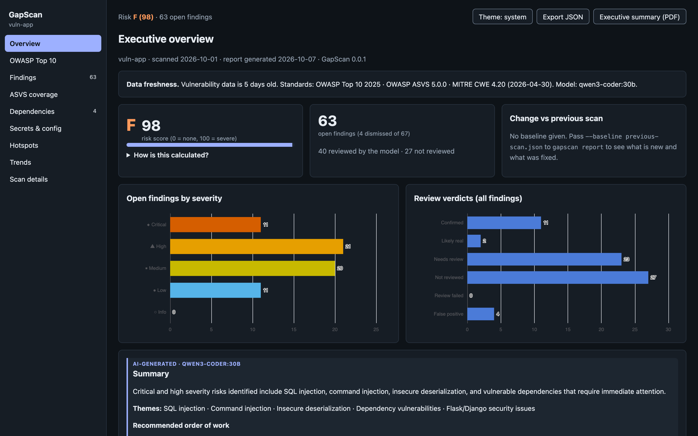
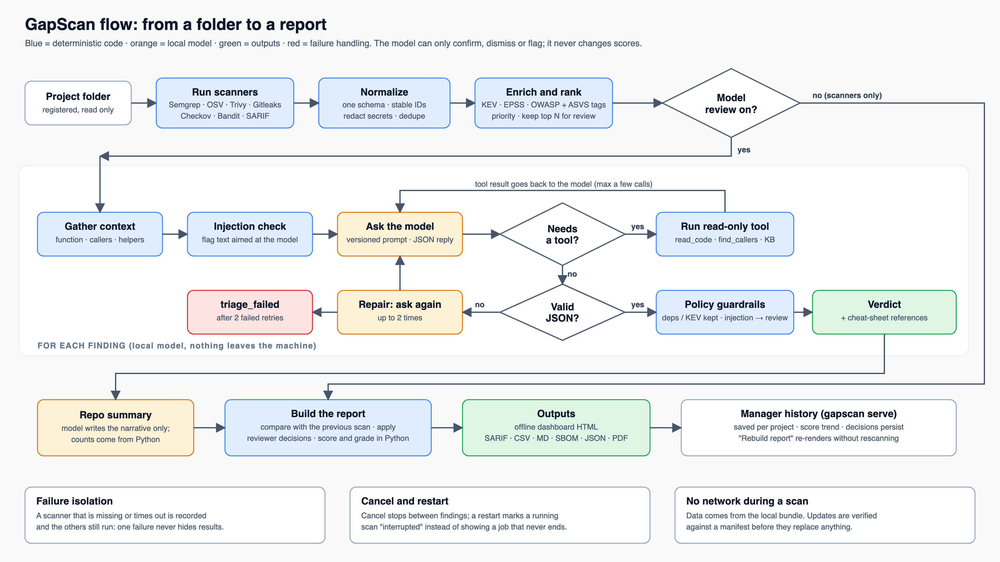

<div align="center">

# GapScan

**The free, offline security scanner that tells you which OWASP requirements your code misses, with proof.**

GapScan scans a codebase on your own machine, maps every finding to OWASP Top 10:2025, ASVS 5.0,
API Security Top 10 and MASVS, and backs each one with evidence: a scanner result, a data-flow path
or the quoted code. An optional local AI model triages, explains and proposes fixes. Your code
never leaves the machine.

[](docs/offline.md)
[](pyproject.toml)
[](docs/rules.md)
[](LICENSE)
[](#evaluation-read-this-before-trusting-any-number)

[](docs/images/report-overview.png)

*The report dashboard: one self-contained HTML file, no CDN, no network.*

</div>

> **Status: early alpha.** The numbers in the [evaluation](#evaluation-read-this-before-trusting-any-number)
> are measured and published with their weaknesses. Read them before relying on the tool.

## What it does

### Scan
Runs Semgrep, OSV-Scanner, Trivy, Gitleaks, Checkov and Bandit (plus any SARIF file) over a folder
and merges everything into one finding schema with **stable IDs**. Secret values are redacted.

- **Own rule library**: Apache-2.0 Semgrep rules in 9 languages, each with tests, CWE and a
  fix-oriented message ([`docs/rules.md`](docs/rules.md)).
- **Cross-file data flow**: GapScan's own taint engine follows attacker data through helpers and
  across files in Java, Python and JavaScript/TypeScript, and shows the whole path as evidence
  ([`docs/taint.md`](docs/taint.md)).
- **Supply chain**: dependency reachability (is the vulnerable function actually called?), CISA KEV
  and EPSS enrichment, known-malicious and typosquat packages, container images and IaC
  ([`docs/supply-chain.md`](docs/supply-chain.md)).

### Map to the standard
Every finding carries the OWASP controls it breaks. The dashboard shows coverage per standard in
three states, never two: **gap** (evidence shows the control is not met), **checked, no finding**,
and **needs a person** (code cannot prove it either way). Static analysis cannot prove code is
secure, so GapScan never says "passed".

### Review with a local model (optional)
A local model (Ollama by default) reads the surrounding code, traces where values come from, calls
read-only lookup tools and answers *true / likely / false positive / needs review*. Provable cases
(weak algorithms, provable noise) are decided by code, not by the model. Every model answer is
schema-validated; invalid output is retried, then marked `triage_failed`. Without a model, scanning,
mapping and the report all still work.

### Deep dive and fix
For the top confirmed issues the model writes an audit-style investigation, and every cited
`file:line` must have been shown to it. `gapscan fix` proposes a patch and offers it only if a
rescan shows the finding gone. Nothing is applied automatically.

### Report
One offline HTML dashboard plus SARIF, CSV, Markdown, CycloneDX SBOM, JSON and PDF exports. All
numbers are computed in Python; the dashboard only renders them.

### Manage and automate
- `gapscan serve`: a local web UI (loopback only) for projects, scan history and your decisions
  (false positive, accepted risk, fixed), and the desktop app around it.
- `gapscan ci run`: scans only what a change introduced, applies your `monitor / comment / block`
  policy and writes pull-request comments. Also a GitHub Action, a pre-commit hook, GitLab, Jenkins
  and Azure templates, and a VS Code extension ([`docs/ci.md`](docs/ci.md)).
- `gapscan mcp`: lets AI coding assistants scan the code they write.
- Verified offline bundles carry vulnerability data and rules to air-gapped machines
  ([`docs/offline.md`](docs/offline.md)).



## Built to be trusted

| | |
|---|---|
| **Offline** | No network calls during `scan`. The model endpoint must be localhost or an explicitly configured internal host. |
| **Read-only** | The scanned code is read, never executed, built, installed or imported. |
| **Untrusted input** | All scanned content is treated as data (prompt-injection risk). Agent tools are read-only and confined to the target directory. |
| **Redacted** | Secret values are redacted in findings, cache, logs and reports. |
| **Evidence** | Every finding links to a scanner result or quoted code. AI-only findings are labeled as such. |
| **Validated** | Model output is schema-checked; it is never silently accepted. |
| **Not steerable** | The scanned project cannot configure or silence the scanners: its own ignore files are ignored, and findings silenced inline (`# nosec`, `nosemgrep`) are still reported, marked as suppressed. |

The one exception to "no network" is the setup wizard you start yourself, which downloads only from
hosts pinned in `runtime/manifest.json` and checks every file against a pinned sha256.

## Quick start

Requirements: [uv](https://docs.astral.sh/uv/) and the scanners on your `PATH`
(`semgrep osv-scanner trivy gitleaks checkov bandit`). [Ollama](https://ollama.com) only if you want
AI review. The Docker image bundles the scanners.

```bash
make setup                       # Python deps via uv
cp config/gapscan.example.toml gapscan.toml
uv run gapscan doctor            # what is installed, what is missing
uv run gapscan data fetch        # needs network once: OWASP data into data/

uv run gapscan scan ./my-project -o scan.json
uv run gapscan report scan.json -t ./my-project
uv run gapscan serve --open      # or the local web UI
```

With a local model:

```bash
ollama pull qwen3-coder:30b      # or a smaller profile: gapscan model list
uv run gapscan kb build          # local knowledge base for the reviewer
uv run gapscan triage scan.json -t ./my-project --limit 40 --deep-dive -o triage.json
uv run gapscan report scan.json --triage triage.json -t ./my-project
```

Large local data (vulnerability databases, models, the knowledge base index: several GB) lives in
`data/` and is not in this repository; the commands above recreate it. Desktop app and packaging:
[`docs/packaging.md`](docs/packaging.md).

**Languages:** Python, JavaScript/TypeScript, Java, Kotlin, Go, Swift, Dart, C# and PHP. Coverage is
uneven: cross-file data flow covers Java, Python and JavaScript/TypeScript only, and Dart/Flutter
detection is still weak.

## Evaluation (read this before trusting any number)

`make eval` runs hand-labeled sites, the OWASP Benchmarks for Java and Python and, optionally, your
own labeled projects. Method, every result, what failed and the 95% confidence intervals are in
[`docs/evaluation.md`](docs/evaluation.md) and [`docs/results/RESULTS.md`](docs/results/RESULTS.md).
Treat AI verdicts as advisory: the gain over a confirm-everything baseline is real but modest, and
most of it comes from deterministic reasoning in the data-flow tracer, not from the model.

## Docs

| | |
|---|---|
| [`ARCHITECTURE.md`](ARCHITECTURE.md) | the layers, packages and rules for new code |
| [`docs/rules.md`](docs/rules.md), [`docs/taint.md`](docs/taint.md), [`docs/supply-chain.md`](docs/supply-chain.md) | the rule library, the data-flow engine, reachability and malicious packages |
| [`docs/ci.md`](docs/ci.md), [`docs/github-action.md`](docs/github-action.md) | CI, pull requests, IDE and MCP |
| [`docs/manager.md`](docs/manager.md) | the local web UI and its security design |
| [`docs/ai-upgrades.md`](docs/ai-upgrades.md), [`docs/memories.md`](docs/memories.md) | model tiers, autofix, and how your notes guide the reviewer |
| [`docs/offline.md`](docs/offline.md), [`docs/packaging.md`](docs/packaging.md) | bundles, verified updates, the Docker image, the desktop app |
| [`docs/evaluation.md`](docs/evaluation.md) | method, results and failures |
| [`docs/licenses.md`](docs/licenses.md) | licenses of everything GapScan runs, bundles or measures against |
| [`SECURITY.md`](SECURITY.md), [`CONTRIBUTING.md`](CONTRIBUTING.md) | reporting vulnerabilities, contributing |

## Development

```bash
make lint          # ruff, mypy and the import-boundary contracts
make test          # pytest (browser tests need: uv run playwright install chromium)
make rules-test    # every own rule against its vulnerable and safe cases (needs semgrep)
make dashboard     # rebuild the report dashboard (needs node)
make manager       # rebuild the local web UI (needs node)
```

## For teams

GapScan is free and stays free for a single machine. Teams that need shared projects, owners and
due dates, integrations and an audit trail can use GapScan Platform, built on this same engine:
see [gapscan.dev](https://gapscan.dev).

## License and credits

GapScan is licensed under the [Apache License 2.0](LICENSE). Third-party tools, rule sets, data and
models keep their own licenses; see [`docs/licenses.md`](docs/licenses.md) and
[`THIRD_PARTY_NOTICES.md`](THIRD_PARTY_NOTICES.md). The Semgrep community rules (Semgrep Rules
License) are not bundled. OWASP content is CC BY-SA 4.0.

The test fixtures under `eval/fixtures/` (and the rule tests and sample project listed in
`.gitleaks.toml`) contain deliberately fake credentials that the scanners are meant to detect.
